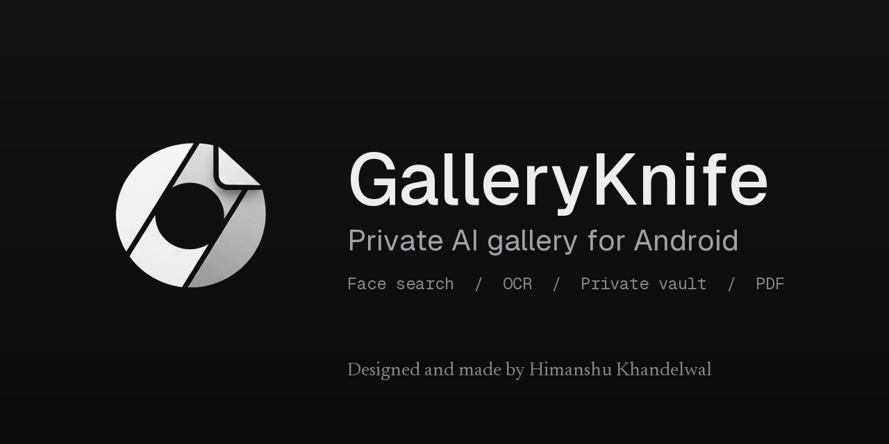

# GalleryKnife: private AI gallery app for Android

**An offline, on-device AI photo gallery and file toolbox.** Search your photos by what is in them, group faces by person, copy text from pictures, hide photos in an encrypted vault, and merge or convert PDFs. No account, no adverts, no cloud upload.

**[Download the APK](../../releases/latest)** · Designed and made by [Himanshu Khandelwal](https://himanshukhandelwal.in)

---

## What is GalleryKnife?
GalleryKnife is an Android gallery app that uses AI that runs **entirely on your phone**. It finds photos by describing them ("beach", "receipt", "dog"), recognises and groups faces so you can name people, reads text inside images, and keeps private photos and videos behind your fingerprint or screen lock. It also works as a file manager for PDFs, Word, PowerPoint, spreadsheets, audio and video.

Because everything is analysed on the device, your photos never leave your phone. That makes it a good fit if you want an **offline gallery app**, a **private photo vault**, or a **gallery without cloud backup or adverts**.

## Features

### AI photo search and organising
- **Search photos by what is in them**: objects, scenes and places, with no typing of file names
- **Search by text in a photo (OCR)**: find receipts, screenshots, notes and documents
- **Face recognition and people albums**: faces are grouped on your phone and you choose the names
- **Search by date and people**: for example "maya 2024" or "yesterday"
- **Copy text from a photo** with one tap

### Private photo and video vault
- **Encrypted private album** for photos and videos, protected with AES-256 and the phone's secure hardware key
- **Locked with your fingerprint, face or screen lock**; hidden from screenshots and the recent-apps screen

### Everyday gallery tools
- **Press and slide to select many photos** at once, row by row
- **Crop, rotate and save a copy**; **trim videos** without losing the original
- **Convert photos to PDF, slides (PPTX) or Word (DOCX)** inside the app
- **Favourites, albums, light and dark mode** and a choice of accent colours with frosted-glass controls

### Files and documents
- **Files tab** that sorts PDFs, Word, slides, sheets, audio and video on your phone
- **Built-in viewers** for PDF, DOCX, PPTX, XLSX, CSV, audio and video
- **Edit text** in Word, PowerPoint and spreadsheet files and save a copy
- **Merge PDFs**: select two or more PDFs and merge them into one
- **Set as default gallery** and open documents straight from other apps

### Updates
- **In-app updates**: GalleryKnife tells you when a new version is out and installs it after you confirm.

## Download and install
1. Open the **[latest release](../../releases/latest)** and download `GalleryKnife-<version>.apk` under **Assets**.
2. Open the file. Android will ask you to allow installs from the app you used to download it.
3. Open GalleryKnife and allow photo access. Optionally allow all-files access for instant delete and the Files tab.

Requires Android 11 or newer. Free for personal use.

## Privacy
Photos, faces, text and files stay on your phone. There are no accounts, no analytics and no adverts. The only internet request is a small check for a newer version, which sends no personal data.

## FAQ

**Is there an AI gallery app for Android that works offline?**
Yes. GalleryKnife runs its photo search, face grouping and text recognition on the phone, so it works without internet.

**How do I hide photos on Android with encryption?**
Select photos or videos in GalleryKnife, tap **Hide**, and they move into the encrypted **Private** album, which opens with your fingerprint or screen lock.

**Can I search photos by what is in them on Android?**
Yes. Type things like "dog", "beach" or "receipt" in the Search tab. It also finds text that appears inside photos.

**How do I merge PDF files on my phone?**
Open the Files tab, choose **PDF**, long-press one file, tap the others, then open the menu and choose **Merge**.

**How do I turn photos into a PDF, PowerPoint or Word document?**
Select the photos, then tap **PDF**, **Slides** or **Word**. The file is saved to Documents.

**Does GalleryKnife upload my photos to the cloud?**
No.

**Is GalleryKnife open source?**
It is **source-available**: you can read the code, but copying, redistributing or commercial use is not allowed. See the licence below.

## Licence: source-available, all rights reserved
This repository is **source-available, not open source**.

| | Allowed |
|---|---|
| Personal, non-commercial use of the app, free | Yes |
| Reading the source to learn or check privacy | Yes |
| Copying, redistributing or re-uploading the code or app | No |
| Selling it, or using it in a paid product | No |
| Modified or rebranded versions | No |
| Removing the credit to the author | No |
| **Use by or for a business or organisation** | **Only with a Commercial Licence (Custom Pack) bought from the author** |

**Businesses and organisations:** to use GalleryKnife commercially you must buy a Custom Pack. Contact [Himanshu Khandelwal](https://himanshukhandelwal.in) to agree scope, price, branding and support.

Full terms: [`LICENSE`](LICENSE). Third-party parts keep their own licences: [`THIRD_PARTY_NOTICES.md`](THIRD_PARTY_NOTICES.md).

## Building for your own use
Allowed for personal use only (see the licence). You need Android Studio, JDK 17 and Android SDK 35. Open the project and run the `app` module.

## Reporting issues
Bug reports and security issues are welcome through the Issues page.

---
Keywords: Android gallery app, AI photo gallery, offline gallery, on-device AI, private photo vault, face recognition gallery, photo search by text, OCR, PDF merge, file manager, video trimmer, Kotlin, Jetpack Compose.
